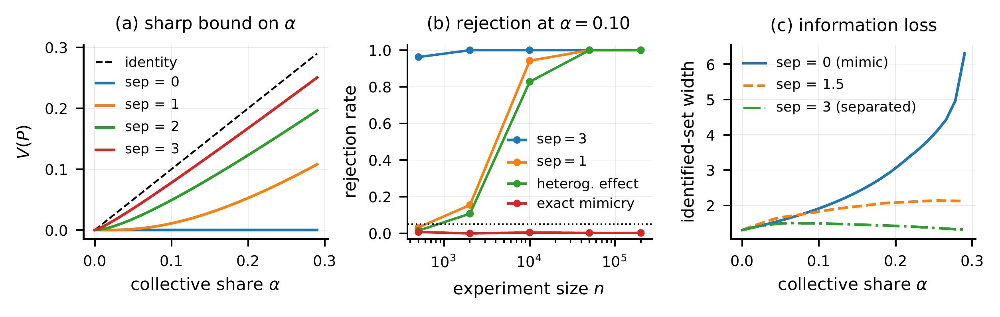
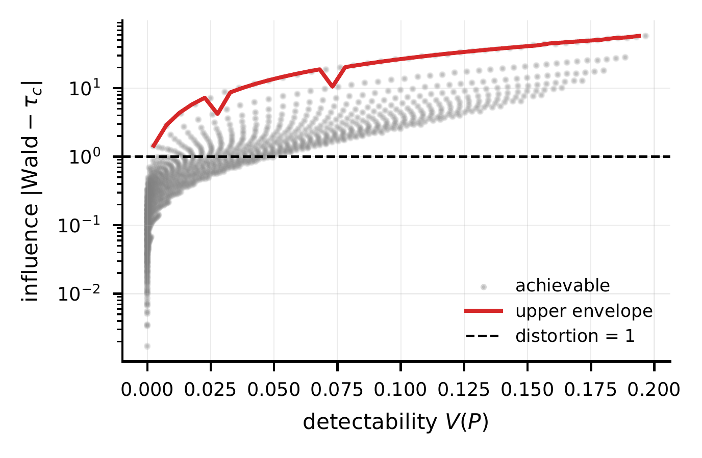

# Instrument Validity as an Audit for Algorithmic Collective Action

**Yi Cui · Accepted at the Economics for Machine Learning (EconML) Workshop at NeurIPS 2026**

**Paper (arXiv): TBD** · [Live project page](https://cymichael.github.io/instrument-validity-audit/) · [EconML workshop](https://econml26-workshop.github.io/)

This repository contains the simulation code and saved results, and a self-contained project page. An arXiv link will be added when the preprint is available. The paper studies whether a randomized encouragement experiment can reveal users who deliberately act against the encouragement—and what the experiment can and cannot tell a platform about the resulting instrumental-variables estimate.

## Overview

In an encouragement design, an instrument `Z` (such as a prompt) is randomized, users choose whether to adopt a treatment `D`, and an outcome `Y` is observed. A **defier** takes the treatment when not encouraged and refuses it when encouraged. Defiers violate the monotonicity assumption behind the usual local average treatment effect (LATE) interpretation of the Wald instrumental-variables estimate.

The paper studies an observable population quantity, `V(P)`, built from differences between the outcome distributions in the four observed `(Z, D)` groups. Under random assignment, exclusion, consistency, and no interference, `V(P)` is a **sharp lower bound** on the population share of defiers. The paper restates this known identification result with a self-contained proof, then interprets it as an audit for collective action and studies where the audit can fail to detect defiance.

For an outcome set `B`, write `m_dz(B) = Pr(Y ∈ B, D = d | Z = z)` and define `S₁ = m₁₀ − m₁₁` and `S₀ = m₀₁ − m₀₀`. The violation functional is

$$
V(P) = \max\left\lbrace 0,\; S_{1+}(\mathcal{Y}),\; S_{0+}(\mathcal{Y}) \right\rbrace.
$$

Here, `S₊` is the positive part of a signed measure and `𝒴` is the outcome space. In words, the audit looks for outcome mass that cannot be explained by the complier distributions alone. It does not observe principal-stratum membership directly.

The central qualification is that a small or zero audit value does not prove that no defiers exist. Defiers can be observationally masked when their potential-outcome measures are dominated by those of compliers. The audit also tests a joint set of assumptions: interpreting a detected violation as defiance requires exclusion to hold, and interpreting defiance as coordinated behavior requires additional behavioral assumptions.

## Key findings

- **The bound is sharp.** The observable violation `V(P)` is the smallest defier share compatible with the observed outcome distributions under the paper's assumptions. It is a bound on population defiance, not a way to identify particular users.
- **Non-detection has limits.** Exact outcome mimicry can make defiers undetectable; with a positive first stage, exact mimicry leaves the Wald estimand equal to LATE. More generally, measure domination can conceal defiers even when effects differ.
- **A small violation can coexist with a large Wald distortion.** In one near-mimicry simulation, the defier share is 29%, the complier effect is 1.0, the first stage is 0.01, the Wald estimand is −0.45, and `V(P) = 0.0022`. This is an illustrative design, not an empirical estimate.
- **Power depends on the outcome distributions and design.** Simulated rejection rates vary with outcome separation, sample size, partition choice, participation, and exclusion violations. The paper does not present these rates as universal guarantees.

## Figures

### Main simulation results



**Figure 1.** Panel (a) plots population `V(P)` against the defier share `α` at four outcome separations. Panel (b) shows simulated rejection rates at `α = 0.10`. Panel (c) shows the identified-set width for the complier effect of midpoint-coded outcomes. The rejection-rate experiment uses 400 replications, a fixed 12-cell outcome partition, and a 5% nominal level. Exact mimicry lies inside the composite null, so non-rejection is expected in that case.

### Detectability and influence



**Figure 2.** Each point is a simulated pair of `V(P)` and absolute Wald distortion in one Gaussian family. The curve is a numerical envelope over a finite parameter grid; it is not a general feasibility boundary, equilibrium result, or recommendation for how a collective should act.

The PNG versions above are project-page exports. Running the scripts generates PDF figures under `code/figs/`.

## Reproduce the results

The scripts use Python, NumPy, SciPy, and Matplotlib. The simulations are CPU-only and require no external data, API keys, or network access. Python 3.10 or newer is recommended.

Install dependencies from the repository root:

```bash
python3 -m pip install -r code/requirements.txt
```

Run the main simulations and robustness analysis from `code/`:

```bash
cd code
python3 run_experiments.py
python3 robustness.py
```

The full main run uses 400 replications and 1,000 Gaussian calibration draws; it took about 85 seconds on the machine used for the revision. The robustness run also uses 400 replications. For shorter runs, pass `--quick` to either script:

```bash
python3 run_experiments.py --quick
python3 robustness.py --quick
```

To regenerate the main figures from the checked-in `results.json` without rerunning the main simulation:

```bash
python3 run_experiments.py --figs-only
```

The main script writes updated results to `code/results.json` and PDF figures to `code/figs/`. The robustness script writes `code/results_robustness.json` and the generated LaTeX table to `code/tab_robustness.tex`. These commands overwrite those generated files. The project-page PNGs in `site/assets/` are checked-in exports and are not regenerated by the scripts. The existing scientific regression tests can be run from `code/` with:

```bash
python3 -m unittest -v test_audit.py
```

See [`code/README.md`](code/README.md) for additional reproduction notes and [`code/requirements.txt`](code/requirements.txt) for dependencies.

## Project page

The live project page is published at **[cymichael.github.io/instrument-validity-audit](https://cymichael.github.io/instrument-validity-audit/)**. GitHub Pages deploys the contents of `site/` whenever a commit is pushed to `main`; the source is plain HTML, CSS, and JavaScript with local assets and no build step.

To preview the page locally from the repository root:

```bash
python3 -m http.server 8765 --bind 127.0.0.1 --directory site
```

Then visit <http://127.0.0.1:8765/>. Keep `site/assets/` beside `site/index.html` so the paper, figures, and download links work.

## Repository contents

```text
code/
  audit.py                 Core identification and audit routines
  run_experiments.py       Main simulation and figure generation
  robustness.py            Robustness analysis and LaTeX table output
  results.json             Saved main simulation results
  results_robustness.json  Saved robustness results
  requirements.txt         Python dependencies
  test_audit.py            Scientific regression tests
site/
  index.html               Static research project page
  assets/                  PDF, figure previews, and downloadable archives
```

## Citation

```bibtex
@misc{cui2026instrumentvalidity,
  author = {Cui, Yi},
  title  = {Instrument Validity as an Audit for Algorithmic Collective Action},
  year   = {2026},
  note   = {Accepted at the Economics for Machine Learning (EconML) Workshop at NeurIPS 2026}
}
```

## License

The software in `code/` and project-page source in `site/` are licensed under the MIT License; see [`LICENSE`](LICENSE). The figures and other research materials remain subject to their respective rights and terms.
